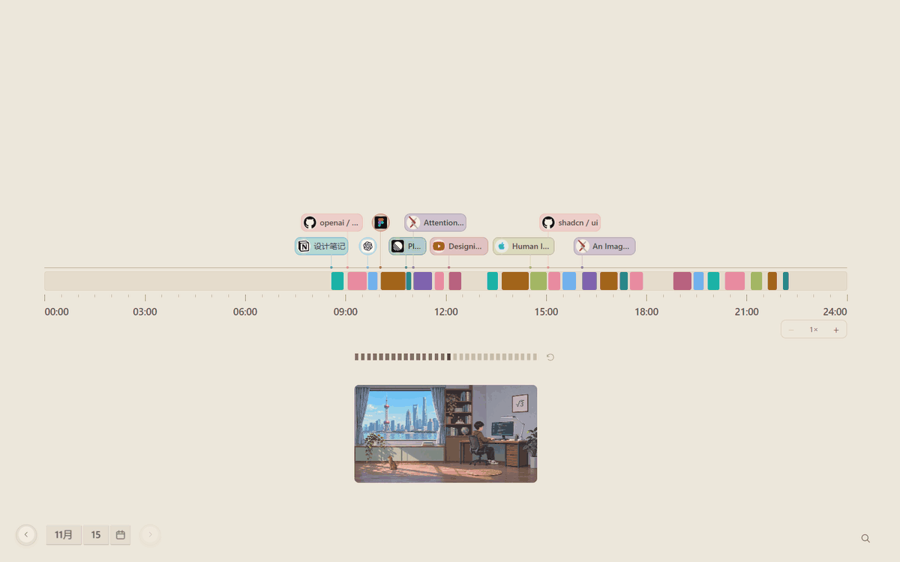

  <picture>
    <source media="(prefers-color-scheme: dark)" srcset="assets/brand/pageago-wordmark-dark.svg">
    
  </picture>

Find the pages you visited, and when.

  
  

  <a href="#installation">Installation</a>
  &nbsp; · &nbsp; <a href="https://github.com/XXXia-art/pageago/issues/new?template=theme-submission.yml">Submit a theme</a>
  &nbsp; · &nbsp; <a href="README.md">简体中文</a>

## Installation

Supports **desktop Edge / Chrome 120+**, primarily tested on Windows. The interface is currently in Simplified Chinese.

Download the [project ZIP](https://github.com/XXXia-art/pageago/archive/refs/heads/main.zip) and extract it.

1. Open `edge://extensions` or `chrome://extensions` and enable **Developer mode**.
2. Select **Load unpacked** and choose [`prototypes/trace-next/extension`](prototypes/trace-next/extension).
3. Pin PageAgo to the toolbar and click its icon to open the local timeline.
4. Open the date menu → **设置** (Settings) → **开始记录** (Start recording).

**Recording is off after installation.** Start or pause it in Settings; the choice persists across browser restarts.

### Offline preview

Open [`prototypes/trace-next/dist/index.html`](prototypes/trace-next/dist/index.html), or double-click `Open-PageAgo.cmd` on Windows. The preview uses synthetic data; recording requires the extension.

## Your data stays on your device

PageAgo keeps recordings in your browser. It records the active HTTP(S) page's **URL, title and foreground time** in a focused, normal window. No account, server, analytics or remote activity requests. Icons come from the browser's local cache or bundled assets.

Incognito windows are excluded. It does not read page content, cookies, passwords, forms or browser history.

**Foreground time is an estimate**, not a measure of reading, attention or learning.

Timing and data details

- **Timing.** The system-idle threshold is 60 seconds; checkpoints run about every 30 seconds. Gaps over 45 seconds are discarded, and a crash may lose the last unsaved interval.
- **Exports contain full URLs**, including query parameters and fragments. URL username/password fields are removed. Imported JSON stays in the current page's memory and is not added to the recorder.
- **At about 8 MiB, recording pauses** instead of deleting older data. Export before clearing or uninstalling; uninstalling removes the extension's local data.

See the [recorder notes](prototypes/trace-next/extension/RECORDER.md) for measurement and recovery details, and the [technical guide](prototypes/trace-next/README.md) for the import format.

## What's next

The current release is a local preview, loaded manually as an unpacked extension. Planned work: simplify installation, add interface languages, and keep refining browser compatibility and keyboard navigation.

Issues and pull requests are welcome. Include browser/OS versions and reproducible steps; use synthetic data when sharing screenshots or exports.
