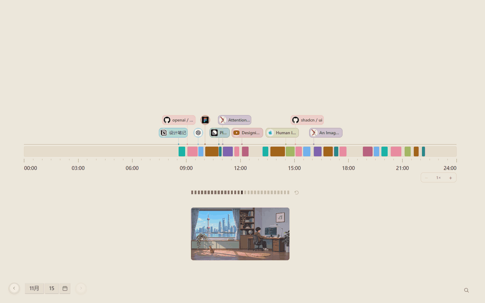

  <picture>
    <source media="(prefers-color-scheme: dark)" srcset="assets/brand/pageago-wordmark-dark.svg">
    
  </picture>

在时间轴上，找回你看过的网页。

  

  <a href="#安装指南">安装指南</a> · <a href="README.en.md">English</a>

## 安装指南

支持 **PC 端 Edge / Chrome 120+**，目前主要在 Windows 上测试。[下载 ZIP](https://github.com/XXXia-art/pageago/archive/refs/heads/main.zip) 并解压，然后：

1. 打开 `edge://extensions` 或 `chrome://extensions`，开启**开发人员模式**。
2. 点击**加载解压缩的扩展**，选择 [`prototypes/trace-next/extension`](prototypes/trace-next/extension) 文件夹。
3. 将 PageAgo 固定到工具栏，点击图标打开本机时间轴。
4. 打开日期菜单 → **设置** → **开始记录**。

**安装后默认暂停**，开始或暂停状态会在重启浏览器后保留。

想先试用，可打开 [`prototypes/trace-next/dist/index.html`](prototypes/trace-next/dist/index.html) 离线演示；Windows 也可双击根目录的 [`Open-PageAgo.cmd`](Open-PageAgo.cmd)。

## 数据保留在本机

记录只保存在本机，无需账号或服务器。仅保存当前获得焦点的正常窗口中，活跃 HTTP(S) 网页的 **URL、标题和前台活动时间**。不采集无痕窗口，不读取网页正文、Cookie、密码、表单或浏览器历史。

记录和显示时间轴不发起远程请求；网站图标来自本机缓存或内置素材。

前台时间为估计值，不代表阅读、专注或学习时长。

计时与数据细节

- 系统空闲阈值为 60 秒，约每 30 秒保存一次；超过 45 秒的保存间隔不补算，崩溃可能丢失最后未保存的一段。
- **导出包含完整 URL**，包括查询参数和片段，可能涉及隐私；URL 中的用户名、密码字段会移除。导入 JSON 仅在当前页面内存中查看，不写入记录器。
- **约 8 MiB 时暂停记录**，不会自动删除旧数据。清空或卸载前请先导出；卸载会移除扩展本地数据。

计时与恢复机制见[记录器说明](prototypes/trace-next/extension/RECORDER.md)，导入格式见[技术文档](prototypes/trace-next/README.md)。

## 接下来

当前为本地预览版，需手动加载扩展。后续计划简化安装、增加界面语言，继续完善浏览器兼容性与键盘操作。

欢迎提交 Issue 或 PR。反馈请附浏览器、系统版本和复现步骤；公开截图与导出文件请使用合成数据。
