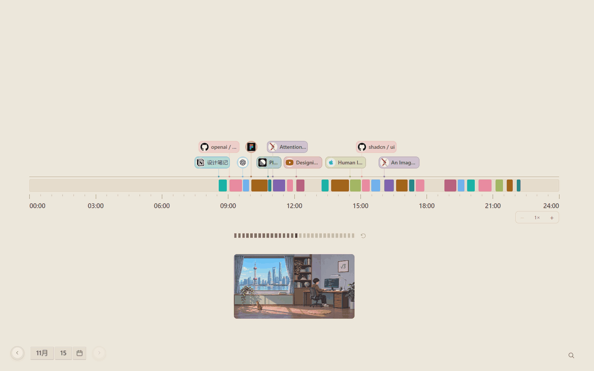

<p align="center">
  <picture>
    <source media="(prefers-color-scheme: dark)" srcset="assets/brand/pageago-wordmark-dark.svg">
    
  </picture>
</p>

<p align="center">把 Edge 与 Chrome 中的网页活动，留在本机的一条时间轴上。</p>

<p align="center">
  
  
  
</p>

<p align="center">
  <a href="README.md">English</a> · 简体中文
  &nbsp; · &nbsp; <a href="#开始使用">开始使用</a>
  &nbsp; · &nbsp; <a href="#数据保留在本机">数据与隐私</a>
</p>


PageAgo 通过浏览器扩展记录前台网页活动的估计区间，用一条时间轴回看每天访问过的网页。无需账号或服务器，当前界面为简体中文。

## 从一天总览，看到某次访问

- **看全局，也看细节。** 色块表示已记录的活动区间。滚轮或捏合缩放，最细可查看 30 分钟；拖动浏览时段，点击网页查看各次访问，同一网站的网页会一起高亮。
- **沿着时间浏览。** 30 格刻度均分全天，每格 48 分钟；拖动刻度查看附近一小时。用翻转日期键切换每天的记录，可开启本地合成的轻微刻度音效。
- **找回某个网页。** 按 `/` 搜索当天的标题或域名，按网站筛选，定位某次访问。可将全部日期导出为 JSON，也可在本地打开兼容的导出文件。



所有截图和演示均使用合成数据。

## 开始使用

下载或克隆仓库：

```sh
git clone https://github.com/XXXia-art/pageago.git
cd pageago
```

### 先试离线演示

从下载的项目中打开 [`prototypes/trace-next/dist/index.html`](prototypes/trace-next/dist/index.html)。Windows 也可以直接双击根目录的 `Open-PageAgo.cmd`。预构建演示无需安装、服务器、Python 或 Node.js。

演示支持日期、缩放、网页详情、搜索和 JSON 导入导出。普通网页无法记录其他标签页；记录自己的活动需要安装扩展。

### 记录自己的网页活动

支持 **PC 端 Edge / Chrome 120+**，当前主要在 Windows 桌面环境设计和测试。

1. 打开 `edge://extensions` 或 `chrome://extensions`，开启**开发人员模式**。
2. 点击**加载解压缩的扩展**，选择 [`prototypes/trace-next/extension`](prototypes/trace-next/extension) 文件夹。
3. 将 PageAgo 固定到工具栏，点击图标打开本机时间轴。
4. 打开日期菜单 → **设置** → **开始记录**。

**安装后默认暂停。** 开始或暂停由你决定，重启浏览器后保留状态。设置中也可以静音、导入、导出和清空数据；清空需再次确认，并同时暂停记录。

## 数据保留在本机

记录保存在浏览器扩展的本地存储中。没有账号、分析埋点、云同步或远程备份；记录和显示时间轴不发起远程请求。网站图标来自浏览器本机缓存或随项目打包的素材。

扩展读取当前网页的 **URL、标题、活动时间**，以及标签页、窗口焦点和系统空闲状态。仅记录获得焦点的正常窗口中当前活跃的 HTTP(S) 网页，不采集无痕窗口，不读取网页正文、Cookie、密码、表单或浏览器历史。

使用时需了解：

- **前台时间是估计值。** 不代表阅读、专注或学习时长。系统空闲阈值为 60 秒，约每 30 秒保存一次；超过 45 秒的保存间隔不补算，崩溃可能丢失最后未保存的一段。
- **导出包含完整 URL**，包括查询参数和片段，可能涉及隐私；URL 中的用户名、密码字段会移除。导入 JSON 仅在当前页面内存中查看，不写入记录器。
- **约 8 MiB 时暂停记录**，不会自动删除旧数据。清空或卸载前请先导出；卸载会移除扩展本地数据。

计时与恢复机制见[记录器说明](prototypes/trace-next/extension/RECORDER.md)，导入格式见[技术文档](prototypes/trace-next/README.md)。

## 开发

预构建页面可离线使用。重新构建需要 Python 3；测试使用 Node.js 22+ 和本机 Chromium 系浏览器，额外的小时刻度测试需要 Playwright。运行库已随仓库打包。

```sh
python prototypes/trace-next/build.py
node --test prototypes/trace-next/tests/recorder.test.mjs
node prototypes/trace-next/tests/dashboard.test.mjs
node prototypes/trace-next/tests/extension.test.mjs
```

构建输出独立网页 `output/pageago.html`，更新演示与扩展，并生成 `output/pageago-extension.zip`。测试使用合成数据和独立临时浏览器配置。其他交互检查与源文件说明见[技术文档](prototypes/trace-next/README.md)。

第三方依赖的来源和许可见 [tldts / Three.js 的 vendor 目录](prototypes/trace-next/vendor/)。早期 Edge 历史导出与学习复盘流程保留在[旧版历史记录工具](docs/legacy-history.md)中。

## 接下来

当前为本地预览版，需手动加载扩展。后续计划简化安装、增加界面语言，继续完善浏览器兼容性与键盘操作。

欢迎提交 Issue 或 PR。反馈请附浏览器、系统版本和复现步骤；公开截图与导出文件请使用合成数据。
