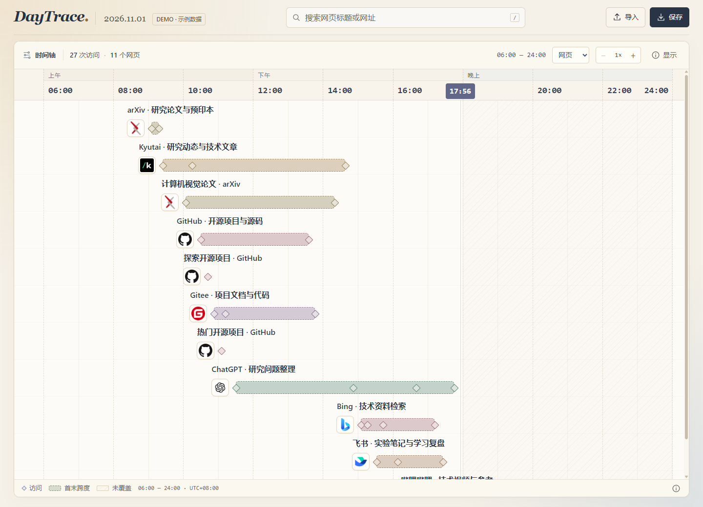

# PageAgo：旧版历史记录工具

这份文档保留基于 Edge 历史访问点的导出与复盘流程。当前浏览器前台活动时间轴、扩展安装与离线演示请看[项目首页](../README.md)。这两类数据含义不同，旧版访问跨度不能作为前台活动时长。

读取 Edge 每次访问，生成可搜索的离线甘特图。Python 标准库负责只读采集，Codex Skill 负责主题分析；HTML 可独立打开。

以 PC 端为主要使用场景，优先优化桌面信息密度、甘特图和鼠标键盘交互；移动端保留基本可用性。



**[打开交互演示](../index.html)** · [示例数据](../examples/demo_history.json) · [Skill 使用说明](../skills/edge-learning-review/SKILL.md)

**旧版活动区间原型**：参考 ActivityWatch 的连续活动区间，使用浅色界面、可展开的网站分组和逐网页横条。支持缩放、详情与离线保存。默认构建使用合成示例，也可使用 `build.py --input <本地 JSON> --output <HTML>` 生成个人快照；根目录 `activity.html` 可能包含个人记录，不用于发布。活动区间与真实访问点分别显示，访问点不推算停留时长。原型源文件在 `prototypes/activity-timeline/`，运行 `python prototypes/activity-timeline/build.py` 可重新生成；旧版访问点时间轴保持独立。

旧版活动区间预览可直接打开根目录 `activity.html`。根目录 `Open-PageAgo.cmd` 现在打开新版浏览器活动时间轴。

[访问点悬浮预览](../docs/daytrace-inspection.png) · [同站点网页分组](../docs/daytrace-page-outline.png) · [手机全天总览](../docs/daytrace-mobile.png)

演示使用 27 次合成访问、11 个网页、8 个公开网站，不代表任何真实用户的活动。下载演示 HTML 后可直接双击体验，无需 Python 或服务器。
下载整个项目后，直接双击根目录的 `index.html` 即可开始；用“导入”载入自己的 JSON。
查看已生成的个人记录，请打开 `output/edge_history_timeline.html`。

## 第一次使用

已安装 Skill 后，在 Codex 输入：

```text
$edge-learning-review 总结我今天的学习，并生成时间轴网页
```

也可以直接运行 Python（已在 Python 3.12 验证，无第三方依赖）：

```powershell
python skills/edge-learning-review/scripts/learning_review.py run
```

若数据库锁定，脚本会说明原因；允许创建用后删除的本地副本时再加 `--copy-if-locked`。
输出位于 `output/`，双击 `edge_history_timeline.html` 查看。

已有数据只需导入：网页中的“导入”支持原始和已分类 JSON，不会访问或上传其他文件。

## 功能

- **甘特图优先。** 画布铺满页面剩余空间，顶部搜索支持标题、网址和域名；用 `/` 或 Ctrl/Cmd+K 聚焦，Esc 清空。
- **主题分析。** Skill 在独立报告中关联论文、源码与笔记；分类可修订，每项推断有访问证据。网页不设主题筛选。
- **本机完成。** 不读取 Cookie、密码或网页正文，不调用外部模型 API。离线网页没有字体、统计或 favicon 网络请求。
- **诚实对待时间。** 菱形是访问，横条是首末跨度。没有前台、焦点和空闲信号时，活动时长与学习时长都保留为未知。

视觉参考[用户主页](https://xxxia-art.github.io/)的暖纸色、衬线品牌字和细边框，布局参考 [Linear Timeline](https://linear.app/docs/timeline) 的连续画布与紧凑操作。去除侧栏、大标题、小时柱图和装饰文案；设计对比与实测见[设计记录](../docs/design-reference.md)。
站点行显示真实站点图标；16 个公开站点的官方图标已随工具打包，打开报告不联网获取 favicon。未收录的站点使用中性占位，图标来源见 [来源记录](../skills/edge-learning-review/references/site-icon-sources.md)。
个人输出、浏览器测试数据和缓存由 `.gitignore` 排除；可用于展示的文件只包含明确标注的合成示例。

## 离线网页时间轴（甘特图）

双击 `output/edge_history_timeline.html` 即可查看。它是一个自包含 HTML 文件，
不需要服务器、网络或额外依赖，也不会上传浏览记录。

- 时间轴固定从本地 **06:00 到 24:00**，访问次数、首末跨度、搜索和详情都按这个窗口统计；06:00 前的原始记录仍保留，保存网页也不会删除。
- 快照尚未覆盖的时间用浅斜纹标出，与“范围内没有访问点”区分；依据导出声明的覆盖时间，不依据最后一次访问。完整日记录不额外着色。
- 横轴为时间，默认每个原网页/配置文件一行，直接显示网页标题；工具栏“网页 / 网站”切换可查看站点概览，完整保留所有访问点及配置文件证据。
- 点击站名先看按网页折叠的清单，以首次访问时间和次数区分相似标题，展开查看重复访问；也可切换到“访问”按时间查看。点击菱形直接打开该次访问的证据，便于从一天总览逐层找到具体网页。
- 浅色甘特画布中，站点图标放在横条左侧，网页视图上方显示页面标题，网站概览只显示简短站点名（如 arXiv、GitHub），随首个访问时间定位；没有固定网页表格列。完整标题、脱敏链接、次数、配置文件和精确时间可在点击后的详情中查看。
- 菱形表示每次真实访问；浅色虚线边框横条连接首次至末次访问，**仅表示访问跨度，不是持续活动区间**。单次访问不画横条。
- 搜索标题、网址和域名；可组合关键词，如 `GitHub 文档`，顺序不限，同一网页需同时匹配所有词。支持固定 06:00–24:00 时间轴的缩放和访问详情。“显示”菜单提供网站/网页分组、排序、配置文件和跨度开关。
- 放大后搜索会将画布外的命中访问移入可视区，保留倍率和输入焦点；清空或按 Esc 返回搜索前的阅读位置。
- 搜索命中词在预览和详情中以浅暖色强调，便于从长标题、同站点网页清单和链接中定位内容。
- 点击站名旁的小箭头，在甘特图内展开该站点的网页；子行显示网页标题，点击可查看记录。折叠后恢复网站概览，访问点始终保留且不重复。[查看展开效果](../docs/daytrace-expanded.png)。
- 悬浮或键盘聚焦横条查看首末访问时间，点击打开记录；时间尺随指针显示本地时间参考线，便于对齐阅读。
- 悬浮访问点可预览完整标题与秒级时间；密集访问保留所有记录，支持左右方向键逐次查看、Home/End 跳到该行首末访问、Enter 打开详情。
- `+ / −` 缩放时保持正在看的时间；Ctrl/Cmd + 滚轮以指针定位，双击刻度放大，点击倍率还原。横向滚动时站名保持可见，原始访问坐标不动。
- 手机打开时也能看到完整的 06:00–24:00 总览；点击 `+` 放大查看密集访问，点击倍率回到全天。时间字保持 18px，通过减少刻度避免拥挤。
- 可在页面中离线导入其他原始或已分类 JSON，并保存为新的独立网页。
- 展示的日期来自导出文件，不会将历史快照误标成今天。

独立生成网页，不重新读取浏览器：

```powershell
python generate_timeline.py
python generate_timeline.py --input output/learning_classified.json --output output/edge_history_timeline.html
```

默认在 `output/` 和直接的 `YYYY-MM-DD` 日期子目录中查找已知导出，按声明的覆盖截止时间选择，时间相同优先已分类文件，并打印所选路径。可用 `--input` 明确指定文件；不会把历史快照当成今天的新采集。
网页模板与完整生成逻辑位于 `skills/edge-learning-review/assets` 和 `scripts/generate_timeline.py`，
根目录入口复用该逻辑。完整 Skill 流程也会生成网页。

检查数据与流程：`python -m unittest -v test_edge_history_today test_learning_review test_timeline`。
浏览器交互测试：`node tests/browser_timeline_test.mjs`，默认使用本机 Chrome，
可通过 `TIMELINE_TEST_BROWSER` 指定 Chromium 系浏览器路径。测试只使用独立临时浏览器配置，
不会连接或结束正在运行的用户浏览器。

大量网页检查可在运行浏览器测试前设置 `$env:TIMELINE_TEST_STRESS='1'`。
它使用 1,200 个合成网页、4,800 次访问检查网站折叠、网页展开、搜索及完整事件 ID，
并把本机操作耗时写到 `output/*_stress.json`；不读取新的浏览记录。

本轮公开设计参考、三轮交互复查和修正记录见[迭代记录](../docs/design-iteration.md)。

## 每日学习复盘 Skill

`skills/edge-learning-review` 提供 collect → classify → aggregate → review 四阶段流程。
Skill 同时包含独立可运行的只读采集脚本，安装后不依赖本项目路径。

```powershell
python skills/edge-learning-review/scripts/learning_review.py run --copy-if-locked
```

沿用已有导出并分析：

```powershell
python skills/edge-learning-review/scripts/learning_review.py run --input output/edge_history_today.json
```

输出新增 `learning_classified.json`、`learning_summary.json`、`learning_report_YYYY-MM-DD.md`
和离线网页 `edge_history_timeline.html`。
主题分类保留访问证据；Codex 可通过本次运行的 assignments 文件修订候选分类，规则与格式详见
`skills/edge-learning-review/SKILL.md` 和 `references/data-contract.md`。

历史记录阶段仅统计访问事件与页面数，活动时长和学习时长均为未知。
此历史导出与学习复盘流程按需执行。当前浏览器前台活动记录请使用[主项目扩展](../README.md#安装指南)；历史访问点与前台活动区间不互相替代。

```powershell
python -m unittest -v test_edge_history_today test_learning_review
```

采集脚本在 Skill 中包含一个独立副本；修改采集逻辑时应同步根目录和 Skill 内脚本，测试会验证两者一致。

## 单独导出历史记录

仅使用 Python 标准库，无须安装依赖。脚本从
`%LOCALAPPDATA%\Microsoft\Edge\User Data` 自动发现包含 `History` 的配置文件目录，
通过 `visits` 与 `urls` 关联查询每次访问，保留重复访问和配置文件标识。

```powershell
python edge_history_today.py
```

时间范围是执行开始时电脑本地日期的 00:00 至当时的当前时间，包含两个端点。
Chromium 时间戳按自 1601-01-01 UTC 起的整数微秒转换；输出时间包含本地 UTC 偏移。
午夜与当前时间分别解析本地时区，以处理夏令时切换日。

输出位于执行命令时的工作目录：

- `output/edge_history_today.json`：时间范围、状态、访问事件总数、配置文件统计、错误和 `visits` 数组。
- `output/edge_history_today.csv`：每行一次访问，列为 `profile,visit_id,url,title,visit_time`，使用 UTF-8 BOM。

页面标题来自 `urls` 当前保存的标题，不是访问发生时的历史标题。

## 数据库锁定时

脚本通过 SQLite `mode=ro` 和 `PRAGMA query_only=ON` 只读查询，不修改、清空或删除浏览器数据库。
如果数据库被 Edge 锁定，脚本会明确报告原因，不会结束浏览器进程或自动复制数据库。
你可以自行关闭 Edge 后重试。

如需保持 Edge 运行，可明确允许本地临时复制：

```powershell
python edge_history_today.py --copy-if-locked
```

此选项允许在无法直接只读访问时，将 `History` 及存在的 SQLite WAL、rollback journal
复制到工作目录下的唯一临时目录。脚本核对复制前后源文件的大小、修改时间、SHA-256
以及副本校验值，再对副本执行完整性检查和只读查询，最后删除副本。
如果发现 WAL，会使用副本避免 SQLite 在源目录创建或写入 SHM 文件。
不复制 SHM；副本需要的 SHM 仅在临时目录生成。

源文件持续变化、权限不足、损坏或日志需要写入恢复时，脚本会报告失败，不会强行忽略日志。
最多尝试获取三次稳定副本。副本只包含当时已经落盘且可一致读取的数据。

单个配置文件失败不会阻止其他配置文件导出，但退出码为 1，JSON 状态标记为 `partial`
或 `failed`，并在 `errors` 中保留原因。所有配置文件成功时退出码为 0。
未发现数据库时直接报错，不生成容易被误认为成功的空结果。

可选参数：

```powershell
python edge_history_today.py --user-data-dir ".\my-browser-data" --output-dir ".\output"
```

脚本不访问 Cookie、密码或其他无关个人数据，不包含网络请求或上传功能。

## 测试

```powershell
python -m unittest -v test_edge_history_today
```

测试仅使用人工构造的本地数据库，覆盖重复访问、时间边界、时间戳转换、多配置文件、
数据库锁定、WAL 中的访问、只读源文件、错误状态及 JSON/CSV 编码。
